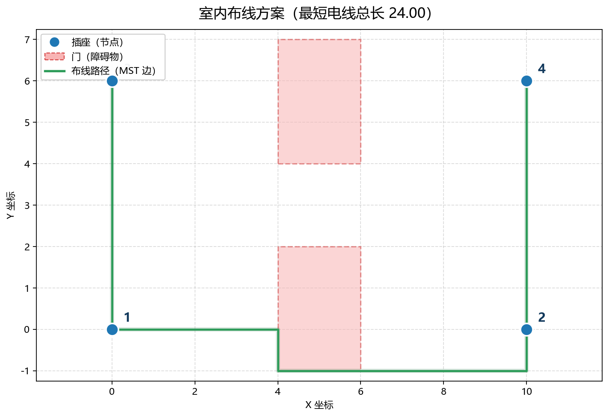
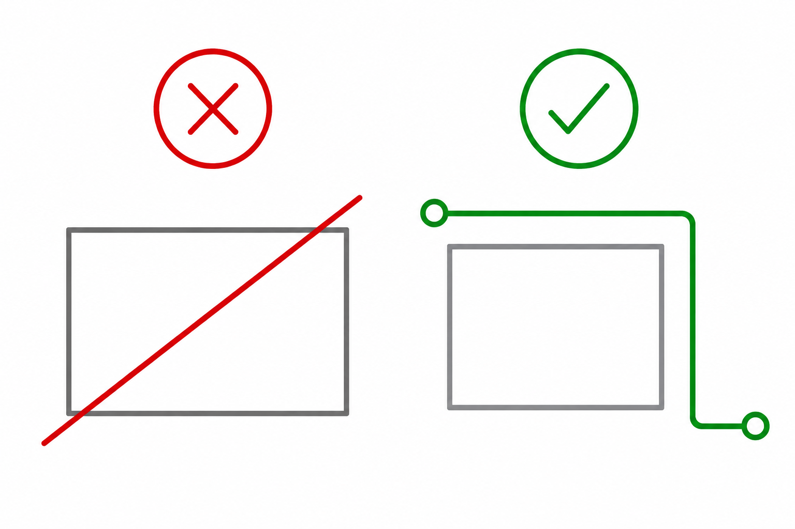
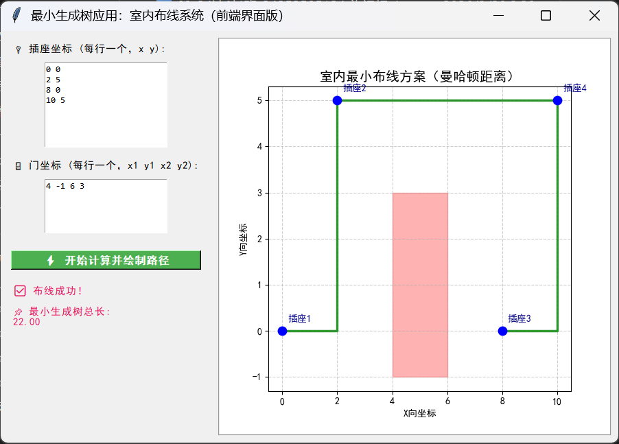
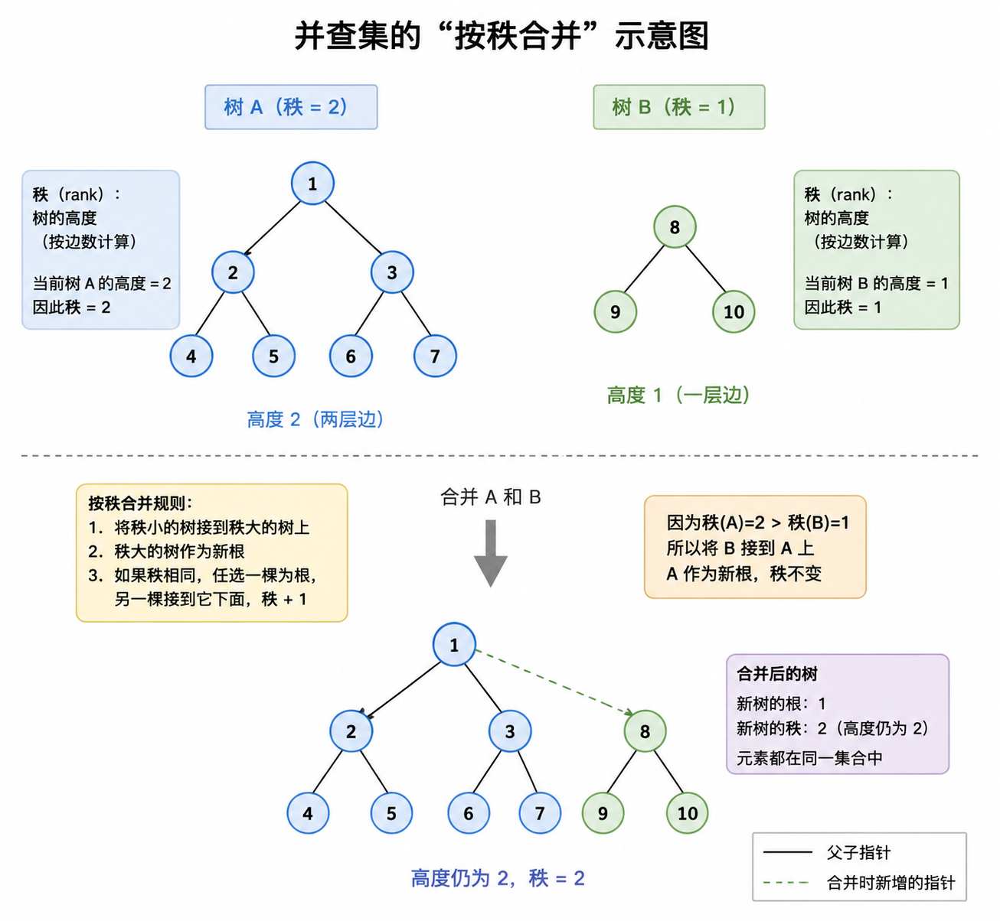
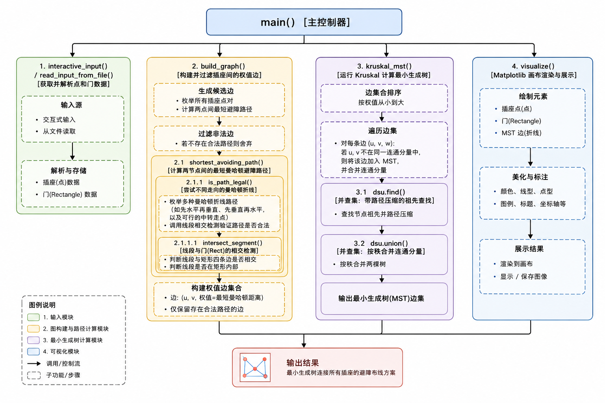

# 室内布线优化系统 · 基于最小生成树

> **广东财经大学《数据结构课程设计》课程作业**
>
> 在若干插座之间铺设电线，电线只能横平竖直走线、不能穿过门，求总长度最短的布线方案。

把装修时"电线怎么走最省"的问题抽象成一张带障碍约束的完全图，用 **Kruskal 最小生成树** 求全局最省方案，并提供命令行与图形界面两种使用方式。



---

## 一、问题从哪来

室内装修的隐蔽工程里，插座位置是固定的，电线需要把它们全部连通。实际施工有两条硬性约束：

| 约束 | 说明 | 数学表达 |
| --- | --- | --- |
| **横平竖直** | 电线沿墙走，只能水平或垂直铺设 | 曼哈顿距离 `d = dx + dy`（`dx`、`dy` 为两个方向的差值） |
| **不能穿门** | 门洞、承重墙不能直接穿过去，必须绕行 | 线段不能穿过矩形区域 |

目标是在满足约束的前提下，让所有插座连通所用的电线总长度最短。



<div align="center"><sub>左：电线直接斜穿门洞，不合规；右：沿门框绕行，合规但更长。系统要做的就是在所有合规方案里挑最短的那个。</sub></div>

## 二、功能特性

| 模块 | 基础版 `indoor_wiring.py` | 进阶版 `app_gui.py` |
| --- | --- | --- |
| 交互方式 | 命令行问答 | Tkinter 图形界面 |
| 数据输入 | 键盘逐点输入 / 读取文本文件 | 文本框批量粘贴 |
| 路径计算 | 任意两点间避障最短曼哈顿路径 | 同一套算法 |
| 最小生成树 | Kruskal + 并查集 | 同一套算法 |
| 结果展示 | 终端打印每条路径 + Matplotlib 出图 | 界面内嵌画布实时绘制 |
| 异常处理 | 图不连通时给出明确提示 | 弹窗提示 |

核心能力：

- **避障最短路径**：先尝试两种曼哈顿折线（先横后竖 / 先竖后横），一旦与门相交，就以门的四个角点为中转点搜索绕行方案，取最短的合规路径。
- **最小生成树**：把所有插座对之间的最短合法路径作为边权，构建完全图，用 Kruskal 算法求解；并查集同时使用**路径压缩**与**按秩合并**。
- **可视化**：插座、门、以及由多段曼哈顿折线组成的实际布线轨迹一并绘制。

## 三、运行效果

图形界面（进阶版）：



上面这份是课程给定的测试样例：4 个插座、1 个门，最短电线总长 **22.00**。门的左右两侧各自成组，中间用一段水平线在门的上方连通。

命令行模式下会输出完整的布线明细：

```text
选择输入方式：1-交互式输入  2-从文件读取（文件格式见说明）: 2
请输入文件名: sample.txt
成功读取 4 个插座和 1 个门

正在计算插座间的最短可行路径……
路径计算完成！

最短电线总长度：22.00

布线方案（插座编号从一开始，边及长度）：
 插座1 到插座 2 | 长度：7.00 | 路径：(0.0, 0.0)->(2.0, 0.0)->(2.0, 5.0)
 插座3 到插座 4 | 长度：7.00 | 路径：(8.0, 0.0)->(10.0, 0.0)->(10.0, 5.0)
 插座2 到插座 4 | 长度：8.00 | 路径：(2.0, 5.0)->(10.0, 5.0)
```

## 四、算法设计

### 4.1 怎么把房间变成一张图

- **顶点**：每个插座是一个顶点；
- **边**：任意两个插座之间都尝试连一条边；
- **边权**：两点之间**不穿门的最短曼哈顿路径长度**。如果怎么走都会被门挡住，这条边就不存在；
- **求解**：在剩下的这张带权无向图上跑最小生成树，总权值即最短电线总长。

> 为什么是"完全图 + 最小生成树"？因为只要求所有插座连通、不要求冗余回路，这正是最小生成树的定义；而曼哈顿距离满足三角不等式，边权构成度量闭包，Kruskal 得到的就是该图上的最优连通方案。

### 4.2 避障最短路径 `shortest_avoiding_path`

对给定两点 `p1`、`p2`：

1. 生成两种曼哈顿折线候选：`p1 → (p2.x, p1.y) → p2` 与 `p1 → (p1.x, p2.y) → p2`；
2. 用 `intersect_segment()` 判断每段是否与任意门矩形相交（端点落在矩形内、或与四条边有交点都算相交）；
3. 若两条都合法，取较短者；
4. 若都被挡住，则以所有门的**四个角点**为候选中转点 `c`，枚举 `p1 → c → p2`，在合法方案中取最短。

这样得到的路径天然是"贴着门框走"的折线——电缆沿墙角、门框敷设，符合实际施工习惯。

### 4.3 并查集：按秩合并 + 路径压缩



Kruskal 每加入一条边就要判断两端是否已连通，用并查集把这一步降到近似常数时间：

- `find` 带**路径压缩**，查询时把沿途节点直接挂到根上；
- `union` 采用**按秩合并**，把矮树挂到高树下，避免树退化成链。

两个优化叠加后，单次操作的均摊复杂度为 `O(α(n))`（`α` 为反阿克曼函数，实际可视为常数）。

### 4.4 复杂度

| 阶段 | 复杂度 | 说明 |
| --- | --- | --- |
| 构图 | `O(n² · m²)` | `n(n-1)/2` 对点，每对最多枚举 `4m` 个角点，每次相交检测 `O(m)` |
| 排序 | `O(n² log n)` | 对 `O(n²)` 条边排序 |
| Kruskal | `O(n² α(n))` | 每条边一次并查集操作 |
| 空间 | `O(n²)` | 存储边集与路径 |

课程要求插座数量通常不超过 30 个，此时整体在亚秒级完成。

### 4.5 模块调用关系



## 五、快速开始

环境：Python 3.8+（开发与测试使用 Python 3.12，Windows）。

```bash
git clone https://github.com/VincentXuwx/indoor-wiring-mst.git
cd indoor-wiring-mst
pip install -r requirements.txt

# 基础版：命令行交互
python src/indoor_wiring.py

# 进阶版：图形界面
python src/app_gui.py
```

> `tkinter` 是 Python 标准库自带组件，Windows / macOS 官方安装包默认已包含。

### 输入格式

第一行是插座数量 `n`，接着 `n` 行每行两个浮点数（插座坐标）；然后一行是门的数量 `m`，接着 `m` 行每行四个浮点数（门矩形的左下角与右上角坐标）：

```text
4          ← 插座数量
0 0        ← 插座 1
2 5        ← 插座 2
8 0        ← 插座 3
10 5       ← 插座 4
1          ← 门的数量
4 -1 6 3   ← 门：(x1, y1, x2, y2)
```

样例数据见 [`data/sample_input.txt`](data/sample_input.txt)，另有 `data/demo_two_doors.txt` 用于生成上面那张双门示意图：

```bash
python demo/render_demo.py data/demo_two_doors.txt docs/images/result-demo.png
```

该脚本会读取数据、调用 `src/` 中的算法求解，并输出一张带中文标注的 PNG（同时修正了 Matplotlib 默认字体缺少中文导致方块的问题）。

## 六、项目结构

```text
indoor-wiring-mst/
├── src/
│   ├── indoor_wiring.py      # 基础版：命令行交互 + Matplotlib 出图
│   └── app_gui.py            # 进阶版：Tkinter 图形界面，内嵌绘图画布
├── data/
│   ├── sample_input.txt      # 课程测试样例
│   └── demo_two_doors.txt    # 双门演示数据
├── demo/
│   └── render_demo.py        # 生成 README 配图（含中文字体处理）
├── docs/
│   ├── course-design-report.pdf   # 课程设计报告（34 页，含设计、测试与源码附录）
│   └── images/                    # 配图
├── requirements.txt
└── README.md
```

课程设计报告完整记录了需求分析、概要设计、模块划分、详细设计与测试过程，见 [`docs/course-design-report.pdf`](docs/course-design-report.pdf)。

## 七、测试用例

| 用例 | 场景 | 预期 | 结果 |
| --- | --- | --- | --- |
| 常规无障碍 | 4 插座 1 门，门不阻断所有通路 | 输出 22.00 及三条路径 | 通过 |
| 直接阻挡绕行 | 两点之间被门正面阻挡 | 自动改走门角绕行 | 通过 |
| 完全隔离 | 门把平面完全隔断 | 提示"没有任何两个插座可以连通" | 通过 |
| 文件读取 | 从 `data/sample_input.txt` 读入 | 正确解析并计算 | 通过 |
| 图形界面 | GUI 输入并绘制 | 画布显示插座、门与布线轨迹 | 通过 |

完全隔离时的输出：


## 八、已知局限与改进方向

这个实现是为课程设计的规模写的，工程化还有不少可以做的：

- **绕行策略是启发式的**：只枚举门的四个角点，遇到"必须多次折返才能穿过狭窄缝隙"的布局，可能不是全局最短解。更严谨的做法是在可视图（visibility graph）上求最短路，或把空间栅格化后跑 A*。
- **MST 不等于最优连通网络**：最小生成树保证"按树形连接"最短，但若允许在空间中新增分叉点（Steiner 点），总长度还能进一步缩短——这是 Steiner 树问题。
- **只支持矩形障碍**：真实房间里的墙体是多段折线，需要扩展几何模型。
- **两份算法的重复实现**：`app_gui.py` 为了提高单文件可运行性，复制了一份核心算法，后续应抽成公共模块。
- **缺少自动化测试**：目前依赖手工测试，可以补充 `pytest` 用例固化上面五个场景。

## 九、说明

本项目为广东财经大学《数据结构课程设计》课程作业，题目来自课程题库，代码与文档仅用于学习交流。

---

<details>
<summary><b>English summary</b></summary>

**Indoor Wiring Optimization with Minimum Spanning Tree** — a data-structures course project.

Given `n` socket positions and `m` rectangular door obstacles on a 2-D plane, find the minimum total cable length that connects all sockets, where cables may only run horizontally/vertically (Manhattan metric) and may not cross a door. The problem is modelled as a minimum spanning tree over a complete graph whose edge weights are the shortest obstacle-avoiding Manhattan paths; edges blocked in both L-shaped variants are routed around door corners. Kruskal's algorithm with a union-find (path compression + union by rank) solves the MST. Both a CLI version and a Tkinter GUI with a live Matplotlib canvas are provided.

</details>
